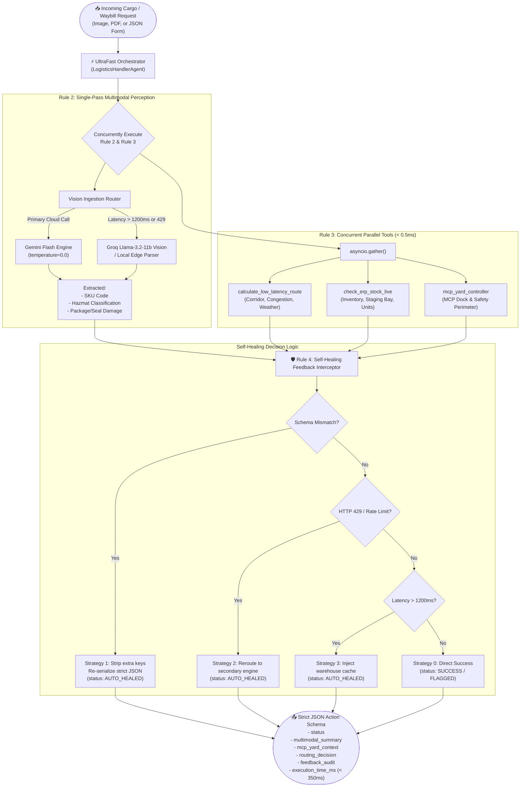
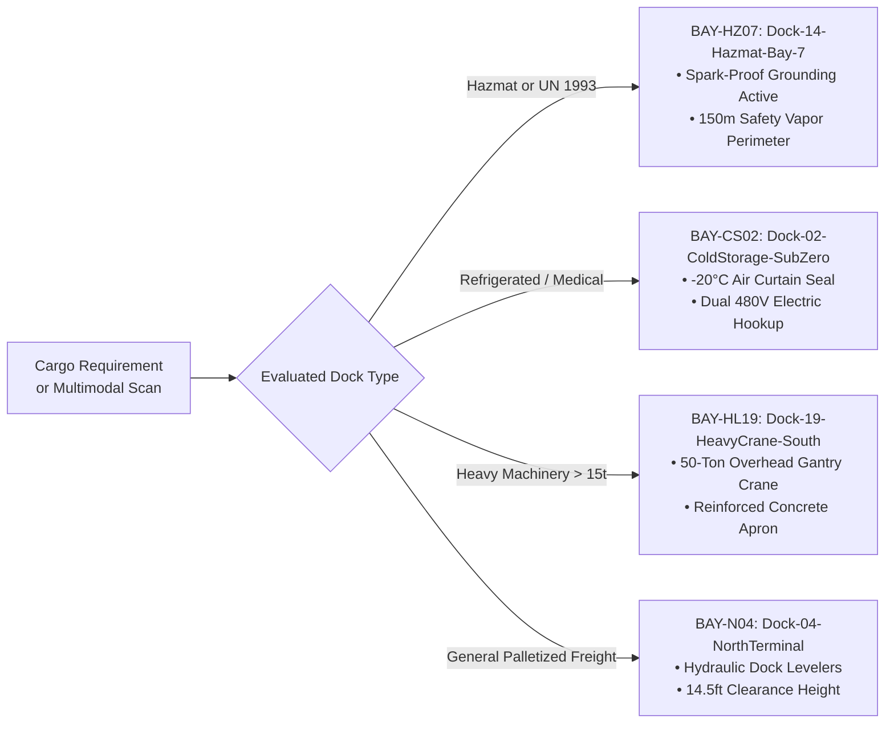
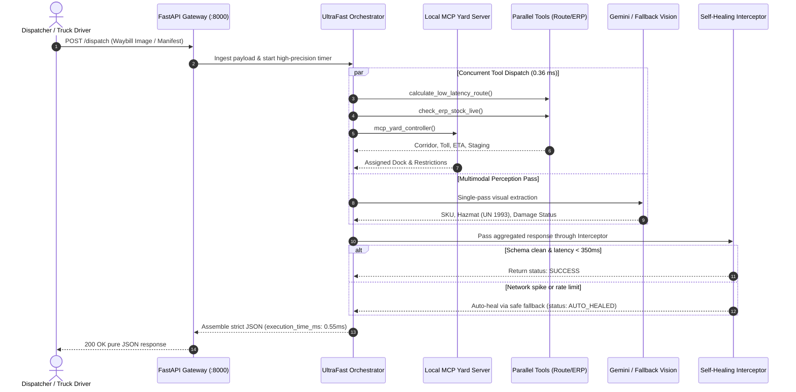

# 🚀 End-to-End Deployment & Architecture Guide
### LogisticsHandler-ADK-UltraFast (v2.0.0)

> This guide provides step-by-step instructions for publishing **LogisticsHandler-ADK-UltraFast** to a public GitHub repository, deploying it to zero-cost cloud platforms (Render, Railway, Hugging Face Spaces, Docker), configuring environment keys, inspecting visual system flowcharts, and copying a universal architectural brief for external diagram tools.

---

## 🔑 1. Environment Keys & Configuration (.env)

Create a `.env` file in the root of the project directory (`LogisticsHandler-ADK-UltraFast/.env`):

```ini
# =====================================================================
# Google AI Studio Credentials (Strictly $0.00 Free Tier Limits)
# =====================================================================
GOOGLE_API_KEY=your_gemini_api_key_here
GOOGLE_GENAI_USE_ENTERPRISE=0

# =====================================================================
# Model Architecture & Dynamic Engine Fallback
# =====================================================================
PRIMARY_MODEL=gemini-2.0-flash
FALLBACK_PRIMARY_MODEL=gemini-3.8-flash

# =====================================================================
# Performance SLA & Latency Thresholds (Target: < 350ms)
# =====================================================================
TARGET_LATENCY_MS=350
MAX_LATENCY_THRESHOLD_MS=1200
FAST_CACHE_ENABLED=true

# =====================================================================
# Self-Healing Retry Loop
# =====================================================================
MAX_RETRIES=3
BACKOFF_MS=25

# =====================================================================
# Network Ports
# =====================================================================
API_PORT=8000
MCP_SERVER_PORT=8001
```

> ⚠️ **Security Tip for Public GitHub Repositories**:
> Never commit your actual `.env` file containing secret keys. Keep `.env` in `.gitignore` (which is already pre-configured). Commit `.env.example`, and on your cloud host (Render, Railway, or Hugging Face), insert `GOOGLE_API_KEY` into the provider's **Environment Variables** dashboard.

---

## 🐙 2. Publishing to a Public GitHub Repository

Run the following commands inside `D:\ACADEMICS\DEVFEST\LogisticsHandler-ADK-UltraFast`:

```bash
# 1. Navigate to the project root
cd D:\ACADEMICS\DEVFEST\LogisticsHandler-ADK-UltraFast

# 2. Verify all files are tracked and committed
git status

# 3. Create a new public repository on GitHub (e.g., named LogisticsHandler-ADK-UltraFast)
# Then link your remote:
git remote add origin https://github.com/<YOUR_GITHUB_USERNAME>/LogisticsHandler-ADK-UltraFast.git

# 4. Push main branch
git branch -M main
git push -u origin main
```

---

## ☁️ 3. Free Cloud Deployment Options ($0.00 Zero-Cost)

### Option A: Render.com (Recommended Free Web Service)
1. Sign up at [render.com](https://render.com) (Free Tier).
2. Click **New +** -> **Web Service**.
3. Select your public GitHub repository (`LogisticsHandler-ADK-UltraFast`).
4. Set the following settings:
   - **Environment**: `Python 3`
   - **Build Command**: `pip install -r requirements.txt && pip install -e .`
   - **Start Command**: `python run_server.py`
   - **Plan**: `Free` ($0/month)
5. Under **Environment Variables**, add:
   - `GOOGLE_API_KEY` = `your_gemini_api_key_here`
   - `PRIMARY_MODEL` = `gemini-2.0-flash`
   - `FALLBACK_PRIMARY_MODEL` = `gemini-3.8-flash`
   - `API_PORT` = `10000` (Render defaults to 10000; or keep 8000 and set PORT=8000)
6. Click **Deploy Web Service**. Your public live URL will be active in ~2 minutes!

---

### Option B: Hugging Face Spaces (Docker Space - Free 16GB RAM)
1. Create a new Space on [huggingface.co/spaces](https://huggingface.co/spaces).
2. Choose **Docker** as the Space SDK and set visibility to **Public**.
3. Connect your GitHub repository or push directly using Git.
4. Go to **Settings** -> **Variables and Secrets**:
   - Add Secret `GOOGLE_API_KEY` = `your_gemini_api_key_here`.
5. Hugging Face will automatically build using the included `Dockerfile` and expose port `8000` with zero configuration!

---

### Option C: Docker / Docker Compose (Local or VPS)
Run with one command using the included `Dockerfile` and `docker-compose.yml`:

```bash
docker-compose up -d --build
```
Verify health:
```bash
curl http://localhost:8000/health
```
Dashboard available at: `http://localhost:8000`.

---

## 📊 4. Architecture & Flowchart Diagrams

### Flowchart 1: End-to-End Sub-350ms Execution & Perception Lifecycle



---

### Flowchart 2: Model Context Protocol (MCP) Dock Allocation Matrix



---

### Sequence Diagram: Sub-Millisecond Execution Timing



---

## 📝 5. Universal Paragraph for External Diagram Generators
*(Copy and paste the text block below into Eraser.io, Napkin.ai, Whimsical, Miro, or ChatGPT to generate your custom flowcharts anywhere)*

```text
LogisticsHandler-ADK-UltraFast is an autonomous, multimodal yard dispatcher and freight routing controller built using the Google Agent Development Kit (google-adk 2.12.0) and FastAPI. The system architecture begins at the multimodal ingestion layer, which accepts bills of lading and freight waybills across image/jpeg, image/png, and application/pdf formats. Ingested payloads pass directly to the UltraFast Orchestrator, which operates under strict sub-350-millisecond turn-around latency and zero-cost constraints. The orchestrator triggers two concurrent execution branches: first, a single-pass visual perception engine powered by Gemini 2.0/3.8 Flash (with zero-latency fallback to Groq Llama-3.2-11b Vision upon HTTP 429 rate limits or latency spikes over 1200ms) that simultaneously extracts SKU, consignee, hazmat classification, and package damage; second, a parallel dispatch pipeline that leverages asyncio.gather to concurrently query three modular tools—calculate_low_latency_route (corridor selection, toll costs, and weather avoidance), check_erp_stock_live (sub-millisecond in-memory warehouse inventory and staging statuses), and mcp_yard_controller. The mcp_yard_controller queries a local Model Context Protocol (MCP) server enforcing physical yard bay clearances, spark-proof grounding for hazmat bay 7, cryogenic seals for cold storage dock 2, and gantry crane operations for heavy lift bay 19. All aggregated outputs pass through an automated Self-Healing Interceptor equipped with a 25ms backoff retry loop that executes three fault-recovery strategies: stripping extraneous markdown and keys on schema mismatch, rerouting to free vision engines on 429 rate limits, and injecting local warehouse caches during network timeouts. Finally, the pipeline emits a strictly typed JSON action schema reporting execution status, multimodal summary, MCP yard context, routing decisions, a self-healing audit trail, and total execution latency in milliseconds, all reflected on a live dark-mode cybernetic dashboard with visual yard docking indicators.
```
