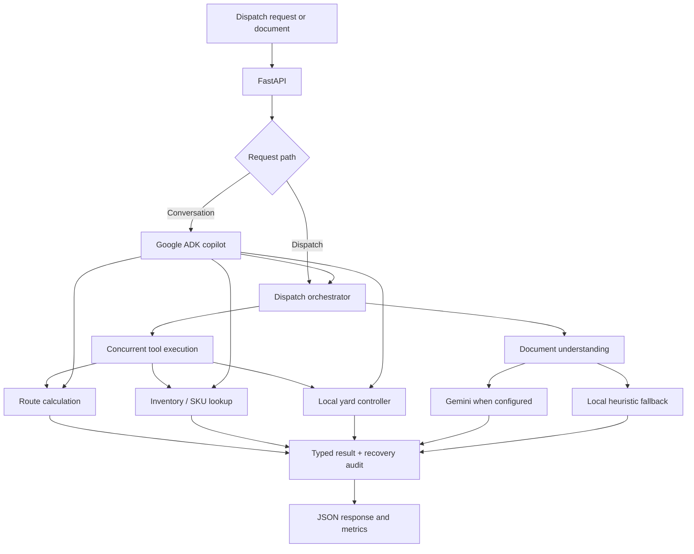

<div align="center">
  
  <h1>VECTRON</h1>
  <p><strong>Autonomous dispatch. Grounded decisions.</strong></p>
  <p>LOGISTICS INTELLIGENCE — multimodal shipment understanding, coordinated dispatch tools, and grounded operational decisions.</p>
  <p>
    
    
    
    
  </p>
</div>

---

VECTRON is an open-source prototype for exploring how AI agents and deterministic tools can work together in logistics operations. It accepts dispatch requests and shipment documents, coordinates route, inventory, and yard checks, and returns a typed dispatch payload with an execution status and recovery audit.

The project began as a DevFest 2026 competition prototype and is now being organized as a standalone engineering project: documented, testable, and open to improvements.

> **Project status:** prototype / educational reference. Routing, inventory, and yard data are local demonstration logic—not live integrations with transportation networks, warehouse ERP systems, or certified safety systems.

## What it does

- **Dispatch API:** accepts shipment metadata and returns a structured dispatch recommendation.
- **Document and image intake:** supports uploads of common image formats and PDFs through the multimodal endpoints. When configured, Gemini is used for image/document understanding.
- **Coordinated tools:** executes route calculation, SKU/staging lookup, and yard selection concurrently.
- **Yard constraints:** resolves STANDARD, HAZMAT, COLD_CHAIN, and HEAVY_LIFT dock classes from a local registry exposed through an MCP-shaped tool interface and JSON-RPC-style endpoint.
- **Recovery and audit:** normalizes model output into typed response models and exercises schema, timeout, and rate-limit recovery paths.
- **Conversational copilot:** includes a Google ADK-powered logistics copilot with tool access and in-memory session history.
- **Observability:** exposes request counts, recent latency measurements, recovery counts, and health information through API endpoints.

## Architecture



The dispatch path uses asynchronous tool fan-out to collect route, inventory, and yard results. Google ADK is used for the conversational copilot; the current dispatch orchestrator coordinates its deterministic tools directly. The local yard controller implements the project's yard registry and exposes tool metadata plus a JSON-RPC-style HTTP route—it is not a separately deployed production yard-management system.

For a component-by-component walkthrough, see [Architecture Notes](docs/architecture.md).

## Quickstart

### Requirements

- Python 3.11 or newer
- A Google AI Studio API key for model-backed image/document analysis
- Git

The text-only dispatch fast path and local tool demonstrations can run without calling a model. Model-backed image/document understanding requires a valid API key and an available model ID.

### 1. Clone and install

```bash
git clone https://github.com/kishorekrrish3/Deep-Stack-AgentWars-DevFest.git
cd Deep-Stack-AgentWars-DevFest

python -m venv .venv
```

Activate the virtual environment:

```powershell
# Windows PowerShell
.venv\Scripts\Activate.ps1
```

```bash
# macOS / Linux
source .venv/bin/activate
```

Install dependencies:

```bash
python -m pip install --upgrade pip
pip install -r requirements.txt
```

### 2. Configure the environment

Copy the example environment file.

```powershell
# Windows PowerShell
Copy-Item .env.example .env
```

```bash
# macOS / Linux
cp .env.example .env
```

Edit `.env` and set `GOOGLE_API_KEY` to your own key. The `.env` file is ignored by Git; never commit real credentials. You can also configure the model names, retry settings, timeouts, and API port there.

### 3. Start the API and dashboard

```bash
python run_server.py
```

Open:

- Dashboard: [http://127.0.0.1:8000/](http://127.0.0.1:8000/)
- Interactive API docs: [http://127.0.0.1:8000/docs](http://127.0.0.1:8000/docs)
- Health: [http://127.0.0.1:8000/health](http://127.0.0.1:8000/health)
- Runtime metrics: [http://127.0.0.1:8000/metrics](http://127.0.0.1:8000/metrics)

## Try a dispatch

With the server running, send a sample shipment:

```bash
curl -X POST "http://127.0.0.1:8000/dispatch" \
  -H "Content-Type: application/json" \
  -d '{
    "bill_id": "WB-DEMO-1001",
    "sku": "SKU-AUTO-1001",
    "origin": "Chicago, IL",
    "destination": "Dallas, TX",
    "cargo_tons": 12.5,
    "dock_type": "STANDARD"
  }'
```

The response is JSON containing the dispatch status, manifest summary, yard selection, routing decision, recovery audit, and `execution_time_ms`. Values from local demonstration tools are illustrative and may change as the implementation evolves.

### Inspect a sample waybill

```bash
curl -X POST "http://127.0.0.1:8000/dispatch/multimodal" \
  -F "file=@data/sample_waybill_clean.png" \
  -F "sku=SKU-AUTO-1001" \
  -F "origin=Chicago, IL" \
  -F "destination=Dallas, TX" \
  -F "cargo_tons=12.5" \
  -F "dock_type=STANDARD"
```

### Query yard rules

```bash
curl "http://127.0.0.1:8000/mcp/yard?dock_type=HAZMAT"
```

### Use the CLI

```bash
# One dispatch
python -m logistics_handler.cli dispatch \
  --bill-id WB-DEMO-1001 \
  --sku SKU-AUTO-1001 \
  --origin "Chicago, IL" \
  --destination "Dallas, TX" \
  --cargo-tons 12.5 \
  --dock-type STANDARD

# Start the conversational copilot
python -m logistics_handler.cli chat

# Ask for a yard assignment
python -m logistics_handler.cli mcp --dock-type HAZMAT

# Exercise recovery scenarios
python -m logistics_handler.cli chaos

# Run the dispatch benchmark
python -m logistics_handler.cli benchmark -n 20 -c 5
```

## API overview

| Method | Endpoint | Purpose |
| --- | --- | --- |
| `GET` | `/health` | Service health and active configuration summary |
| `GET` | `/metrics` | In-memory request and latency metrics |
| `POST` | `/dispatch` | Dispatch a JSON shipment request |
| `POST` | `/dispatch/multimodal` | Dispatch with an uploaded image or PDF |
| `POST` | `/tools/execute` | Execute route, inventory, and yard tools concurrently |
| `GET` | `/mcp/yard` | Resolve a dock from the local yard registry |
| `GET` | `/mcp/tools` | Inspect the local yard tool definition |
| `POST` | `/mcp/call` | Call the local yard tool through the JSON-RPC-style interface |
| `POST` | `/copilot/chat` | Chat with the logistics copilot |
| `POST` | `/copilot/multimodal` | Send a document/image to the copilot |
| `GET` | `/copilot/history` | Read history for an in-memory copilot session |

See the interactive [OpenAPI documentation](http://127.0.0.1:8000/docs) after starting the server for request models and full response schemas.

## Testing and benchmarks

Run the automated tests:

```bash
pytest tests -v
```

Run the comprehensive benchmark:

```bash
python benchmark.py
```

Or run a configurable CLI benchmark:

```bash
python -m logistics_handler.cli benchmark --iterations 20 --concurrency 5
```

**How to read the numbers:** local tool timings, text-only fast-path timings, and model-backed image/document requests measure different work. Results depend on the machine, network, model availability, quotas, and warm/cold state. Use the benchmark output from your own environment; don't treat numbers quoted in old competition materials as a universal latency guarantee. The `/metrics` endpoint stores recent measurements in process memory and resets when the server restarts.

## Current implementation boundaries

Being explicit about boundaries makes the project easier to trust and extend.

| Area | Current state |
| --- | --- |
| Dispatch HTTP API | Implemented with FastAPI |
| Conversational agent | Google ADK copilot with tool access and in-memory session history |
| Parallel dispatch tools | Implemented with asynchronous fan-out |
| Routing and inventory | Local demonstration tools; no live carrier, traffic, or ERP integration |
| Yard compliance | Local rule registry and JSON-RPC-style HTTP tool interface; not connected to a real yard-management system |
| Image/document understanding | Gemini-backed when configured; local recovery logic is heuristic, not local computer vision |
| Self-healing | Schema cleanup and fallback paths, including simulated fault scenarios |
| Provider failover | The current default path is Gemini plus local fallback. Groq/OpenRouter multi-provider failover is not wired as an active end-to-end integration yet |
| Production security | No authentication or production-grade tenant/data isolation; do not expose this service to untrusted users as-is |

## Safety and data handling

- Use synthetic shipment data for demos and tests.
- Do not upload customer documents, personal information, credentials, or confidential freight data to a public demo.
- A successful response is a software recommendation—not proof of regulatory compliance or a substitute for a qualified safety/compliance review.
- Before any production deployment, add authentication, authorization, request-size limits, stricter CORS rules, secret-management controls, privacy review, and integration tests against the actual external systems.

Report a security concern privately according to [SECURITY.md](SECURITY.md).

## Repository map

```text
.
├── logistics_handler/
│   ├── api.py                 # FastAPI endpoints and dashboard route
│   ├── copilot_agent.py       # Google ADK conversational copilot
│   ├── orchestrator.py        # Dispatch workflow and async tool fan-out
│   ├── models.py              # Pydantic request/response schemas
│   ├── mcp_server.py          # Local yard registry and tool interface
│   ├── self_healing.py        # Output cleanup and recovery behavior
│   ├── fallback_engine.py     # Local heuristic fallback
│   ├── tools/                 # Routing, inventory, and yard tools
│   └── templates/             # Dashboard UI
├── data/                      # Synthetic demo waybills and generator
├── tests/                     # Unit and integration tests
├── docs/                      # Project documentation
├── benchmark.py               # Comprehensive benchmark runner
├── run_server.py              # API and dashboard entry point
├── requirements.txt
├── pyproject.toml
├── .env.example
└── SECURITY.md
```

## Roadmap

- [ ] Add CI that runs formatting, static checks, and the full test suite on pull requests.
- [ ] Expand unit and integration coverage for input validation, privacy boundaries, and failure recovery.
- [ ] Separate model-backed latency from deterministic local processing in benchmark reports.
- [ ] Add a proper external MCP server transport and integration tests.
- [ ] Add pluggable provider adapters and test multi-provider failover before advertising it as available.
- [ ] Replace local route/inventory examples with documented provider interfaces and optional real integrations.
- [ ] Add authentication, structured logging with redaction, and production deployment hardening.

## Contributing

Issues, focused bug reports, documentation improvements, and pull requests are welcome. Start with [CONTRIBUTING.md](CONTRIBUTING.md), include reproduction steps for bugs, and run the relevant tests before opening a pull request.

## License

Distributed under the [MIT License](LICENSE).

---

<sub>VECTRON was originally developed as a DevFest 2026 prototype and is being evolved into an independently documented open-source project.</sub>
